# Fancy Plugs

Fourteen VST3 effects for Windows 10 and 11 (x64), built for personal use and signed off by ear in REAPER. Version **1.3.0**.

| Plugin | What it does |
|---|---|
| Fancy Kicker | Low-end enhancer: Boost (one big Freq knob, Wet and Dry) or, new in 1.3.0, Sub, which adds an octave or two below |
| Fancy Exciter | Parallel high-frequency exciter with clip boost and a mix-back control |
| Fancy Comp | Compressor with a Threshold fader over the input meter, a filtered detector, a sidechain and an output limiter |
| Fancy EQ | Up to 16 bands with draggable handles, a live analyzer and, new in 1.2.0, dynamic bands |
| Fancy Verb | Convolution reverb built from a chain of modules: impulse file, filters, echo generator, normalize |
| Fancy Delay | Up to 16 delay taps, each with its own feedback, loop filters, bit crush, width, pan and ping-pong |
| Fancy MultiComp | Up to 8 bands of compression behind flat-summing crossovers and, new in 1.2.0, upward compression |
| Fancy FIR | Spectral processor: drawable EQ, Gate, Compressor, noise Subtract and Convolve, with adaptive noise tracking in 1.2.0 |
| Fancy Gate | Gate with a filtered detector, a sidechain and a MIDI trigger output |
| Fancy Limit | New in 1.3.0: true-peak brickwall limiter with lookahead, three styles, Auto release, a loudness meter and dither |
| Fancy DS | New in 1.3.0: de-esser with a relative threshold, split or wide cuts, minimum- or linear-phase split filters and a history display |
| Fancy DS-Mini | New in 1.3.0: one-knob de-esser with voice and instrument profiles, on the same engine as Fancy DS |
| Fancy Sature | New in 1.3.0: saturator with Tape, Tube, Transistor and Clip curves, even/odd Character, Tone, oversampling and auto gain |
| Fancy Room | New in 1.3.0: algorithmic reverb from small room to long hall, with Freeze, tempo-synced pre-delay, a send mode and ducking |

## What's new in 1.3.0

- **Five new plugins:** Fancy Limit, Fancy DS, Fancy DS-Mini, Fancy Sature and Fancy Room (table above).
- **Sub mode in Fancy Kicker.** A Boost | Sub switch at the top. Sub tracks the kick's pitch and adds a clean sub an octave or two below, under Cutoff. Boost sounds exactly as before.
- **Preset browser in every plugin**, with categories, user folders, favourites and search (see "Choosing presets" below), and the ‹ › arrows on the preset name.
- **Free resizing.** Drag a window's edge or corner to resize it, from 100 % to 200 % of its size; the layout scales with it.
- **Title strip.** Every window shows the plugin's name at the top.
- **Listen switches are temporary.** Comp's and Gate's Preview filter and FIR's Listen switches now turn off when you close the window and are never saved, like the new plugins' Listen. A project saved with one of them on opens with it off; nothing else about old projects changes.

Projects saved with 1.0, 1.1 and 1.2 load and sound exactly as before.

## What was new in 1.2.0

- **Undo, redo, A/B and Compare in every plugin.** There are 100 steps of undo and redo (Ctrl+Z and Ctrl+Y), and two settings slots, A and B, with a copy button. Compare matches the loudness of the dry signal so you can judge the processing at equal level.
- **Styled menus, dropdowns, tooltips, typed values and dialogs** that match the rest of the design, instead of the plain Windows ones.
- **Host compatibility.** Offline renders now match playback. Keys you press reach the host, so the space bar works with a plugin window focused. The plugins follow the host's display scaling, report latency changes to the host, and Comp, MultiComp, FIR and Gate have sidechain inputs. Every plugin passes Steinberg's VST3 validator, pluginval and a host-behaviour test in CI.
- **Dynamic EQ (Fancy EQ).** Any bell, shelf, tilt or notch can be made dynamic, cutting or boosting above or below a threshold, optionally keyed from a sidechain.
- **Upward compression (Fancy MultiComp).** Each band can lift quiet passages, with Max lift and a Floor. Global Depth and Time controls scale the processing, and a "Big squash" preset uses all of it.
- **Adaptive noise tracking (Fancy FIR).** Subtract mode can follow a noise floor that changes over time, using minimum statistics, while leaving speech, music and sustained tones alone. It runs on the learned profile, the tracked one, or both.

Projects saved with 1.0 and 1.1 load and sound exactly as before. Every new parameter defaults to the old behaviour.

## The plugins

The screenshots below are rendered by CI from the current build, at 2× scale.

### Fancy Kicker

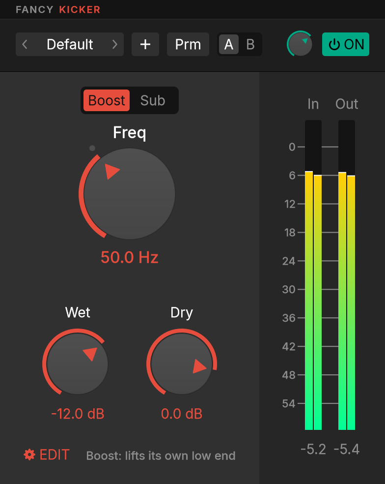 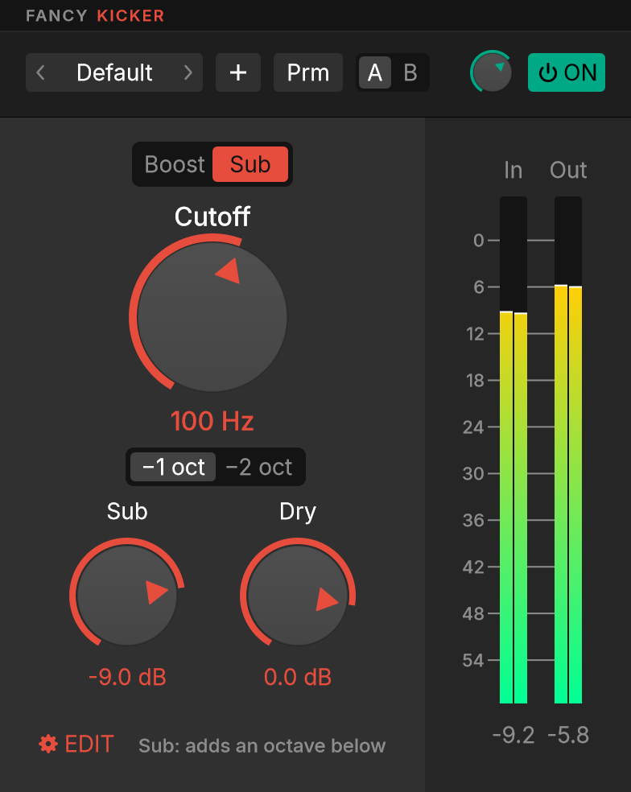

### Fancy Exciter

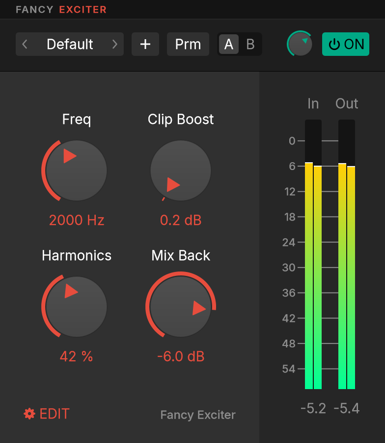

### Fancy Comp

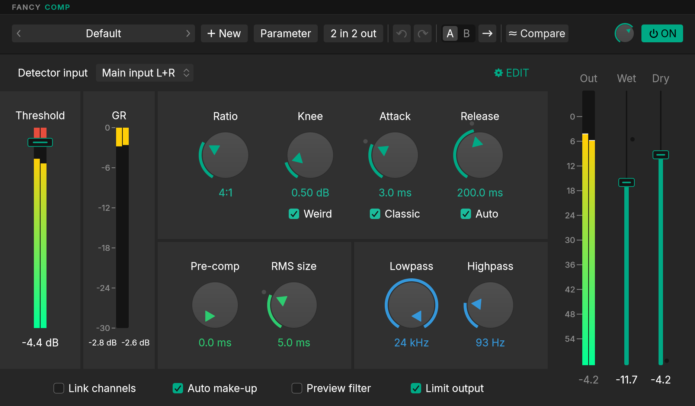

### Fancy EQ

Shown with band 2 set as a dynamic cut. The dashed outline shows the most it can cut, and the filled curve shows what it's cutting right now.

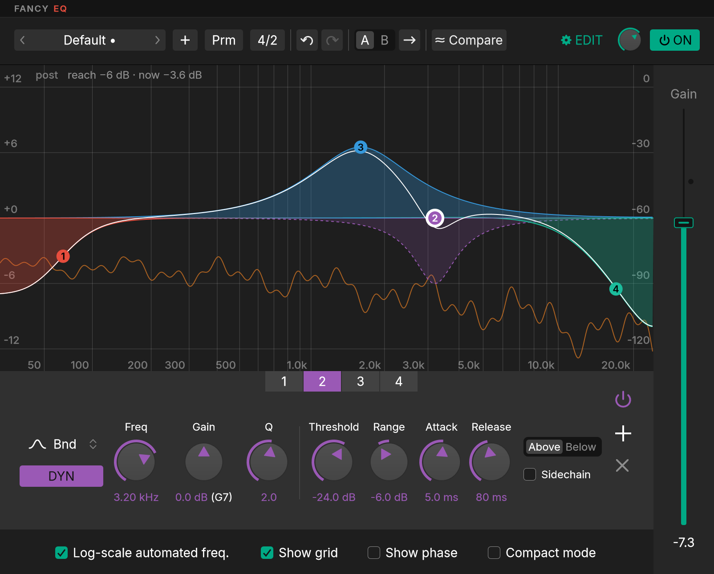

### Fancy Verb

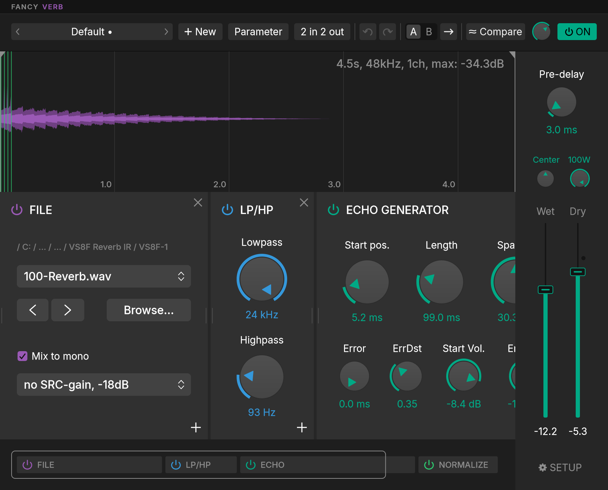

### Fancy Delay

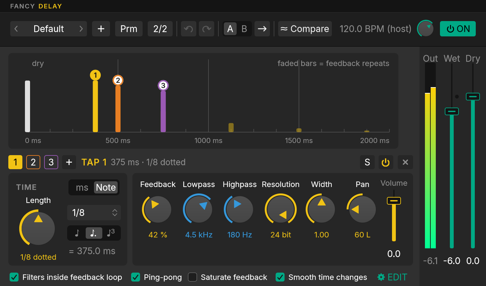

### Fancy MultiComp

Shown with the Upward row for the selected band and the global Depth and Time knobs.

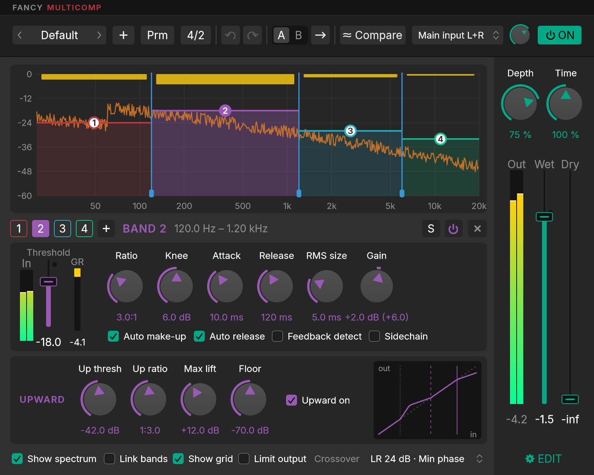

### Fancy FIR

Shown in Subtract mode with Adaptive tracking. The dashed line is the tracked noise profile.

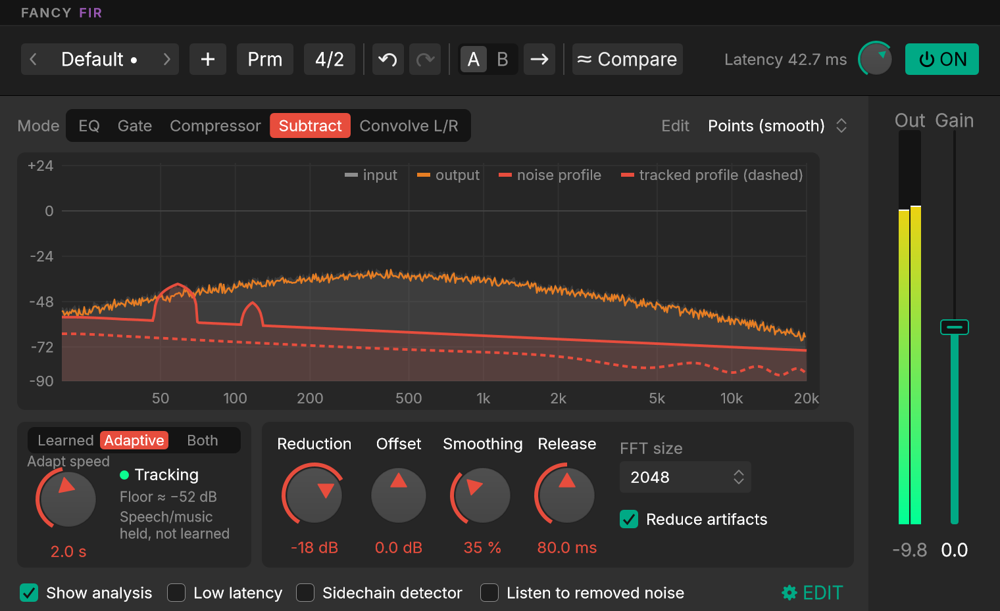

### Fancy Gate

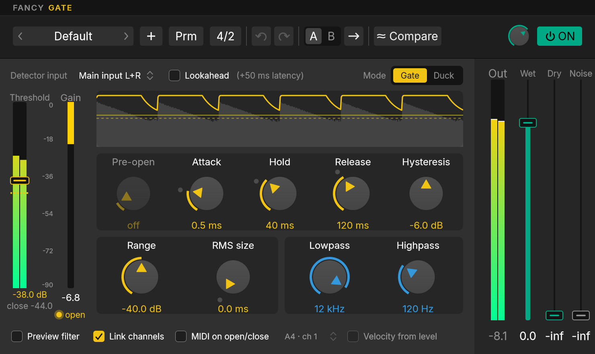

### Fancy Limit

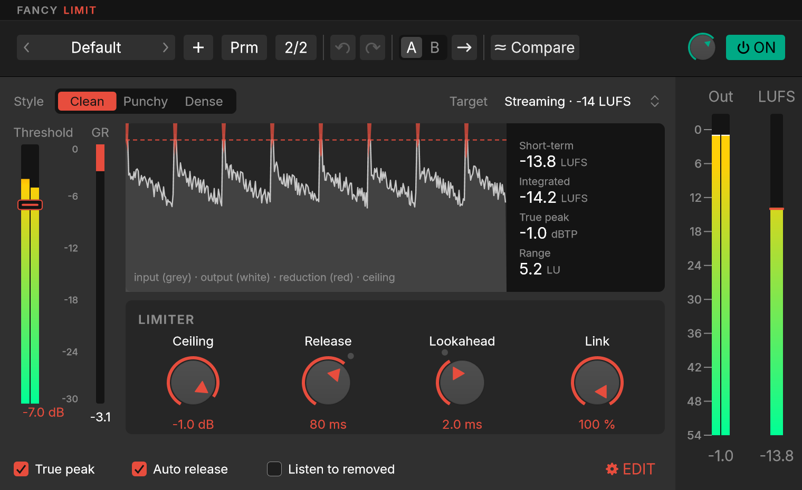

### Fancy DS

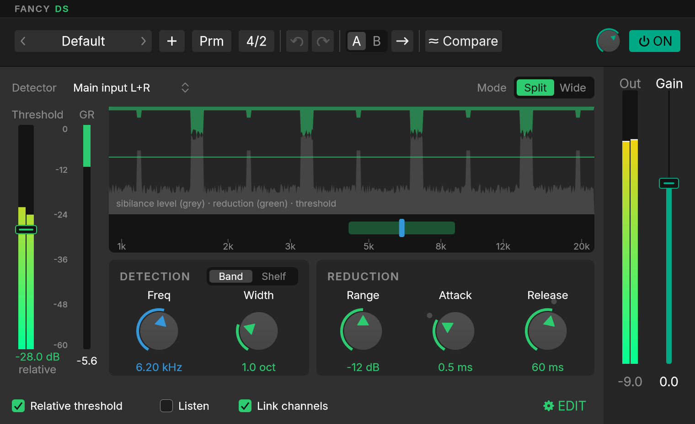

### Fancy DS-Mini

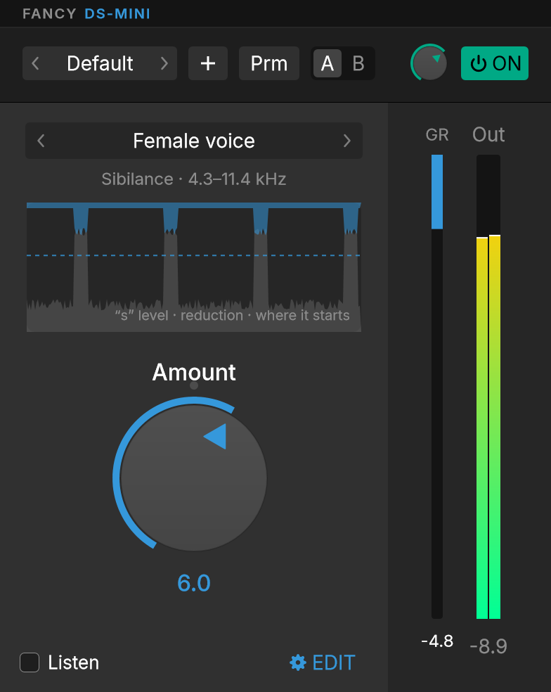

### Fancy Sature

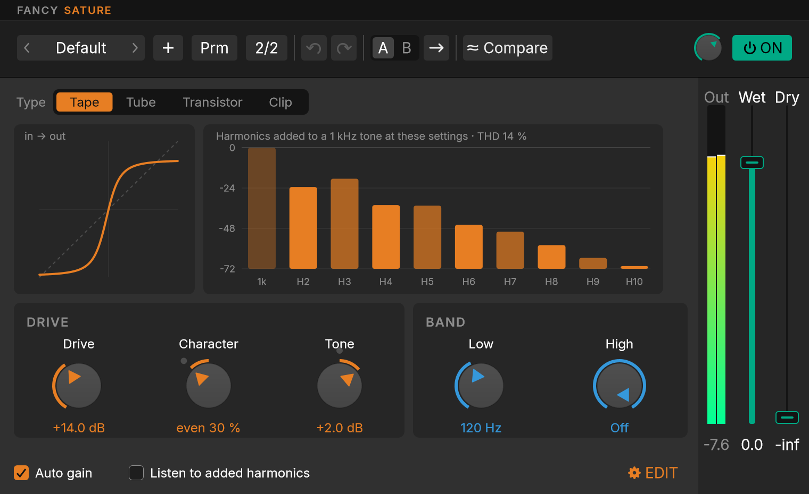

### Fancy Room

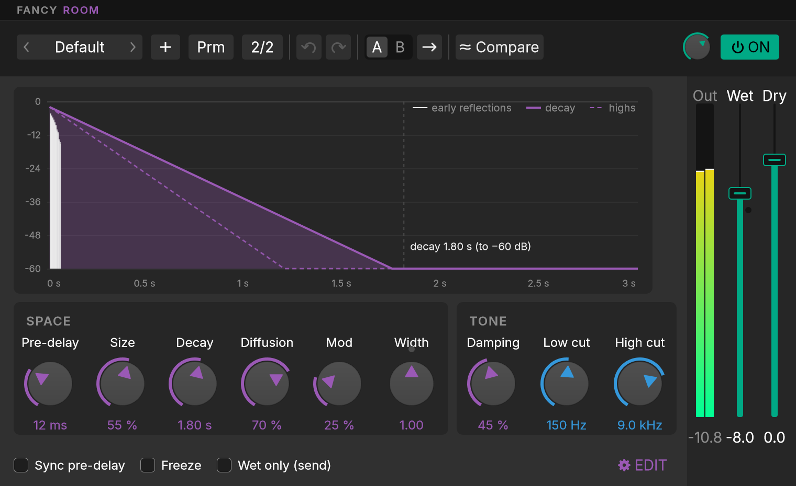

## Installing

Download the latest release's `FancyPlugs-<version>-win64.zip`. Close REAPER, unzip, and run `install.ps1`, which copies the plugins to `%USERPROFILE%\VST3-Dev`. You can also copy the `.vst3` folders to any VST3 path yourself. Then re-scan your plugins in REAPER.

To install the newest CI build instead of a release, run this in the project folder:

```powershell
.\scripts\get-latest.ps1
```

It downloads the newest successful build of the current branch and installs it the same way. It doesn't need admin rights. If REAPER is running, it first asks you to close any project using these plugins, because Windows won't overwrite a loaded DLL.

Add `%USERPROFILE%\VST3-Dev` to REAPER's VST plug-in paths once (Options > Preferences > Plug-ins > VST), and click Re-scan after each install.

## Choosing presets

Click the preset name in the header to open the preset browser. It works the same way in every plugin:

- **One click** on a preset loads it, and the browser **stays open**, so you can try several in a row.
- **Double-click** a preset, or press **Enter**, to load it and close the browser.
- Click outside the browser, or press **Esc**, to close it.
- The star marks a favourite without loading the preset.
- The ‹ › arrows on the preset name step to the previous or next preset without opening the browser.

Each plugin has a manual and a REAPER checklist in `docs/`. `docs/PROGRESS.md` has the full history, test results and measurements.

## How builds work

Nothing compiles on the local PC. Each push runs `.github/workflows/build.yml` on a GitHub Windows runner. The run builds the plugins and runs the DSP tests, Steinberg's validator, pluginval and the host harness. It also renders UI screenshots, then uploads the results as artifacts. Changes that only touch `docs/`, `reference/` or Markdown files don't start a build.

To build a single plugin, run the workflow by hand and pick it:

```powershell
gh workflow run build.yml -f plugin=kicker
```

## Attribution

UI design based on "ReaPlugs (vst GUI)" by Eugene Reznik, CC BY 4.0 — https://www.figma.com/community/file/967866927752067729. Modified from the original.

The Inter typeface is used under the SIL Open Font License; see `assets/fonts/Inter-LICENSE.txt`.
