# Fancy Plugs

Fourteen VST3 effects for Windows 10 and 11 (x64), built for personal use and signed off by ear in REAPER. Version **1.6.0**.

| Plugin | What it does |
|---|---|
| Fancy Kicker | Low-end enhancer: Boost (one big Freq knob, Wet and Dry) or, new in 1.3.0, Sub, which adds an octave or two below |
| Fancy Exciter | Parallel high-frequency exciter with clip boost and a mix-back control |
| Fancy Comp | Compressor with a Threshold fader over the input meter, a filtered detector, a sidechain and an output limiter; new in 1.4.0, Character, upward compression, Auto threshold and a detector EQ |
| Fancy EQ | Up to 24 bands with draggable handles, a live analyzer, dynamic bands and, new in 1.4.0, mid/side per band and Match |
| Fancy Verb | Convolution reverb built from a chain of modules: impulse file, filters, echo generator, normalize; new in 1.5.0, a built-in IR library, true stereo and Modulate |
| Fancy Delay | Up to 16 delay taps, each with its own feedback, loop filters, bit crush, width, pan and ping-pong; new in 1.5.0, Tape and BBD character, modulation, diffusion, ducking and swing |
| Fancy MultiComp | Up to 8 bands of compression behind flat-summing crossovers, with upward compression and, new in 1.5.0, lookahead and mid/side per band |
| Fancy FIR | Spectral processor: drawable EQ, Gate, Compressor, noise Subtract and Convolve, with adaptive noise tracking and, new in 1.6.0, Resonance |
| Fancy Gate | Gate with a filtered detector, a sidechain and a MIDI trigger output |
| Fancy Limit | New in 1.3.0: true-peak brickwall limiter with lookahead, three styles, Auto release, a loudness meter and dither |
| Fancy DS | New in 1.3.0: de-esser with a relative threshold, split or wide cuts, minimum- or linear-phase split filters and a history display |
| Fancy DS-Mini | New in 1.3.0: one-knob de-esser with voice and instrument profiles, on the same engine as Fancy DS |
| Fancy Sature | New in 1.3.0: saturator with Tape, Tube, Transistor and Clip curves, even/odd Character, Tone, oversampling and auto gain |
| Fancy Room | New in 1.3.0: algorithmic reverb from small room to long hall, with Freeze, tempo-synced pre-delay, a send mode and ducking |

## What's new in 1.6.0

- **Fancy FIR: Resonance mode.** A sixth mode that finds narrow peaks standing above the spectrum around them, such as a ringing snare, a boxy vocal or a room mode, and turns each one down by up to Depth only while it's there. Broadband material, plain noise included, changes by well under 0.5 dB.
- **Depth, Sharpness, Attack, Release and Range.** Sharpness sets how narrow a peak must be to count; Range (Low and High) keeps it to part of the spectrum, and the graph dims what's outside. The cut shows in green, hanging from 0 dB.
- **Linked stereo:** both channels get the same cut, so the image never moves. **Listen to removed resonances** plays only what's taken out.
- **Two new presets:** Resonance Tamer and Harsh Vocal (Restoration).

Projects saved with 1.0 to 1.5 load and sound exactly as before.

## What was new in 1.5.0

- **Fancy Verb: IR library.** 32 impulse responses built in, in Rooms, Halls, Plates, Chambers and Special, from a LIBRARY section in the File module's dropdown. A project that uses one stays small, because it stores the name, not the audio.
- **Fancy Verb: true stereo.** Library IRs marked TS, four-channel WAVs and a pair of stereo files (**Pair right input…**) keep each input side's own reflections, so a source panned left still fills the room. The Reverb generator gains Low and High RT, Early reflections (Room or Hall, with Size; Plate is dense from the start), Build-up and a True stereo switch.
- **Fancy Verb: Modulate.** A new module that moves a long tail gently, without pitch wobble, with Rate and Depth. Offline renders stay identical.
- **Fancy Verb: Add module** is now a card in the chain with every module type.
- **Fancy MultiComp: lookahead** from 0 to 10 ms, reported to the host, and **a channel per band:** Stereo, Left, Right, Mid or Side, from a chip on the band row.
- **Fancy Delay: character and motion.** Each tap can be Clean, Tape or BBD, with Amount, and the Motion page adds Rate, Depth, Random and Diffusion. The EDIT drawer adds Ducking and Swing.
- **New presets:** Library Hall, Library Plate, True Stereo Room, Modulated Hall and Endless (Verb); Lookahead Glue and Mid/Side Master (MultiComp); Tape Echo, BBD Chorus Echo, Diffused Wash and Ducked Vocal Echo (Delay).

Projects saved with 1.0 to 1.4 load and sound exactly as before. Every new setting defaults to the old behaviour.

## What was new in 1.4.0

- **Fancy EQ: 24 bands and a channel per band.** Up to 24 bands, and each one can work on Stereo, Left, Right, Mid or Side, from a small chip under its type. The white curve shows the total for the selected band's channel, Linear phase follows the channels in use, and the analyzer can show any one channel.
- **Fancy EQ: Match.** Learn a reference and your material, from the sidechain or captured one after the other, and Match writes ordinary bands into free slots to move your track towards the reference, as one undo step. Amount, Smoothing, the number of bands and a frequency range set how far it goes.
- **Fancy Comp: Character.** A Warm or Bright saturation stage, before or after the compressor, with Drive, using Fancy Sature's curves.
- **Fancy Comp: upward compression,** as in Fancy MultiComp, with Up threshold, Up ratio, Max lift and a Floor, and a transfer curve that shows both directions.
- **Fancy Comp: Auto threshold** follows the input's long-term level, so the gain reduction stays steady between quiet and loud passages. The Threshold meter shows the threshold in use.
- **Fancy Comp: detector EQ and 8x.** A low shelf, a bell and a high shelf shape what the detector hears, with a curve you can drag. Oversampling now goes to 8x. The EDIT drawer has four pages: Detector, Character, Upward and Options.
- **Three new Comp presets:** Warm Bus, Upward Vocal and Level Rider.

Projects saved with 1.0 to 1.3 load and sound exactly as before. Every new setting defaults to the old behaviour.

## What was new in 1.3.0

- **Five new plugins:** Fancy Limit, Fancy DS, Fancy DS-Mini, Fancy Sature and Fancy Room (table above).
- **Sub mode in Fancy Kicker.** A Boost | Sub switch at the top. Sub tracks the kick's pitch and adds a clean sub an octave or two below, under Cutoff. Boost sounds exactly as before.
- **Preset browser in every plugin**, with categories, user folders, favourites and search (see "Choosing presets" below), and the ‹ › arrows on the preset name.
- **Free resizing.** Drag a window's edge or corner to resize it, from 100 % to 200 % of its size; the layout scales with it.
- **Title strip.** Every window shows the plugin's name at the top.
- **Listen switches are temporary.** Comp's and Gate's Preview filter and FIR's Listen switches now turn off when you close the window and are never saved, like the new plugins' Listen. A project saved with one of them on opens with it off; nothing else about old projects changes.

Projects saved with 1.0, 1.1 and 1.2 load and sound exactly as before.

## The plugins

The screenshots below are rendered by CI from the current build, at 2× scale.

### Fancy Kicker

 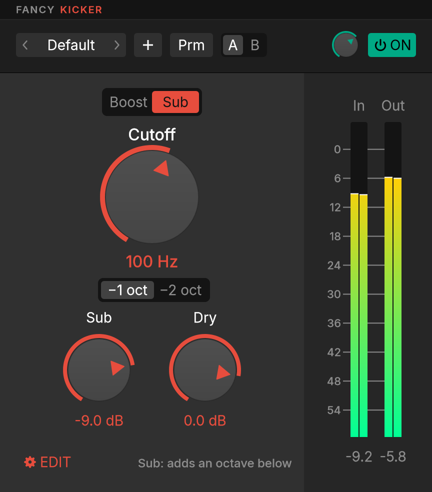

### Fancy Exciter


### Fancy Comp


The EDIT drawer's Upward page, with the static curve and the current lift:

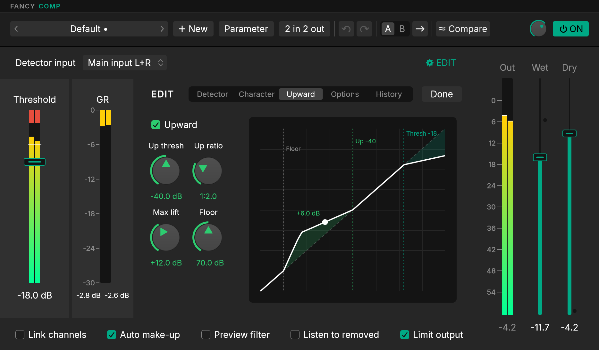

### Fancy EQ

Shown with band 2 set as a dynamic cut. The dashed outline shows the most it can cut, and the filled curve shows what it's cutting right now.


The Match card over a learned reference (purple), the current material (grey) and the target (dashed):

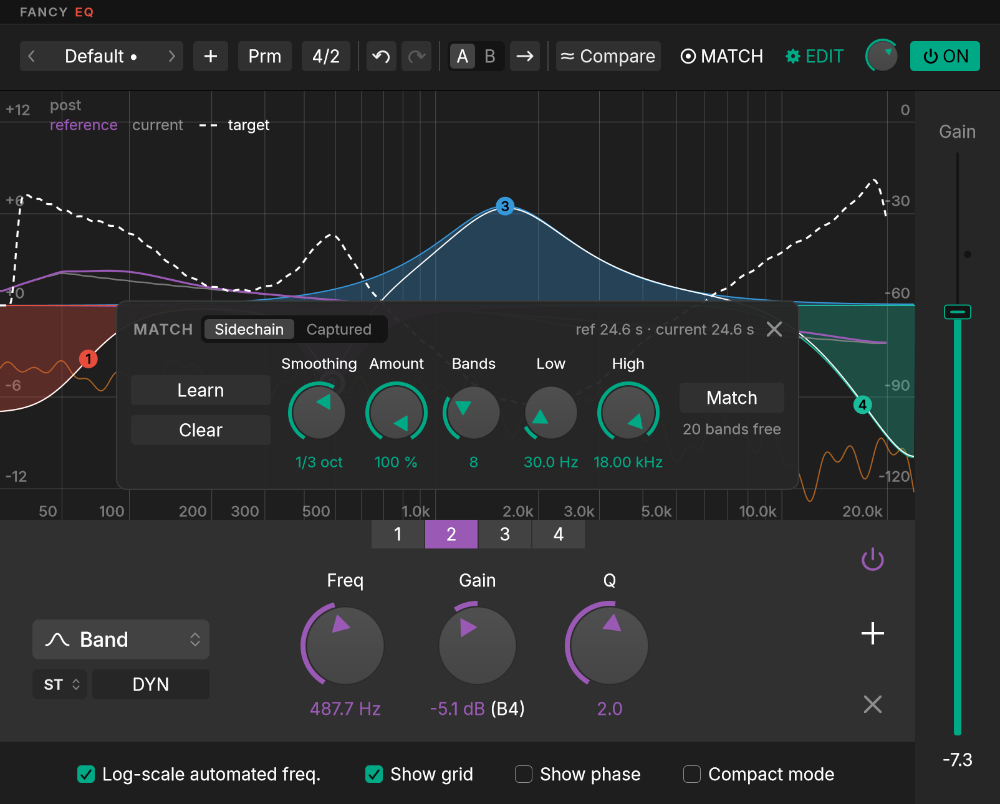

### Fancy Verb

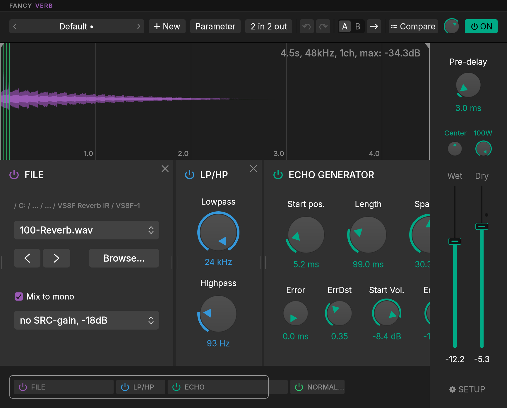

A true-stereo hall from the built-in library:


### Fancy Delay

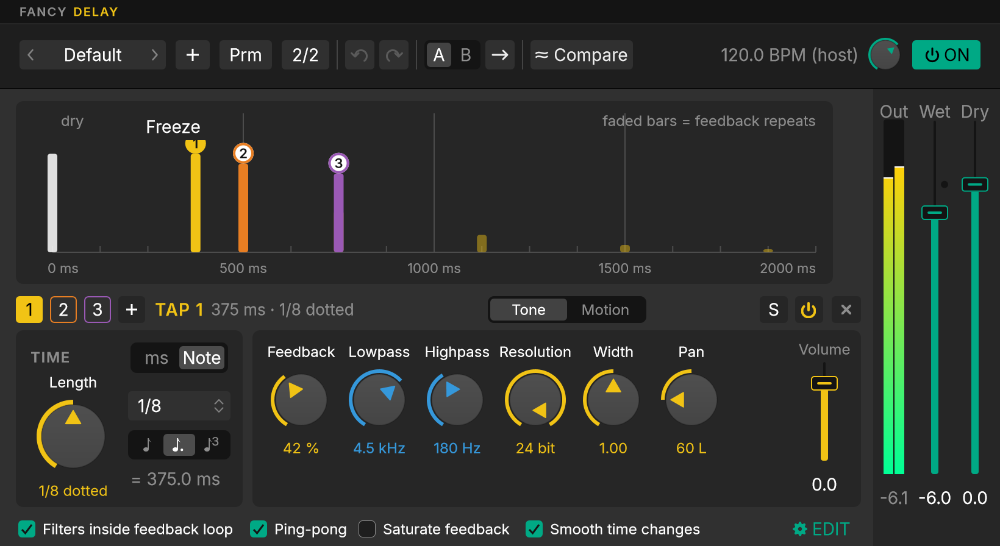

The Motion page, with a Tape tap:

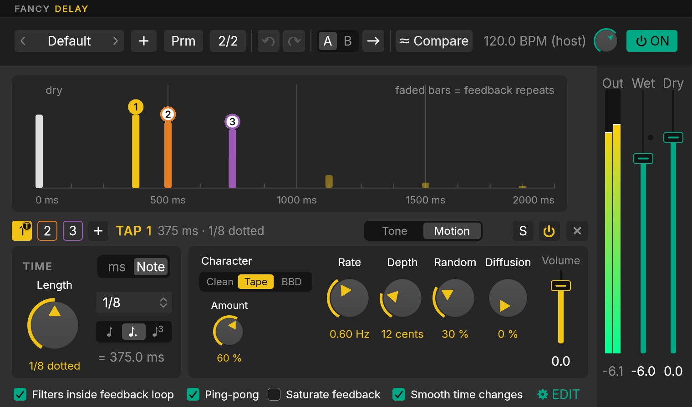

### Fancy MultiComp

Shown with the Upward row for the selected band and the global Depth and Time knobs.


Band 2 set to Mid (the M chip and the M on its handle):


### Fancy FIR

Shown in Subtract mode with Adaptive tracking. The dashed line is the tracked noise profile.

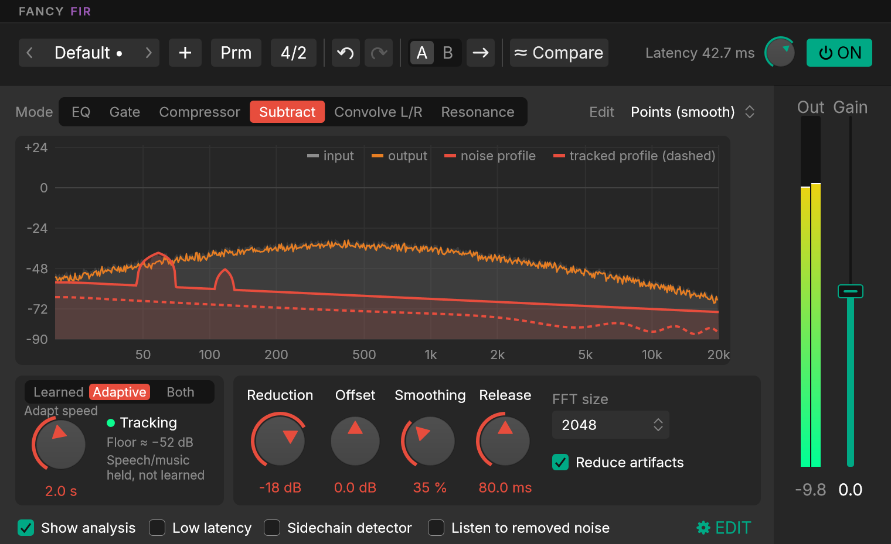

Resonance mode, turning down resonances at 700 Hz and 3 kHz:

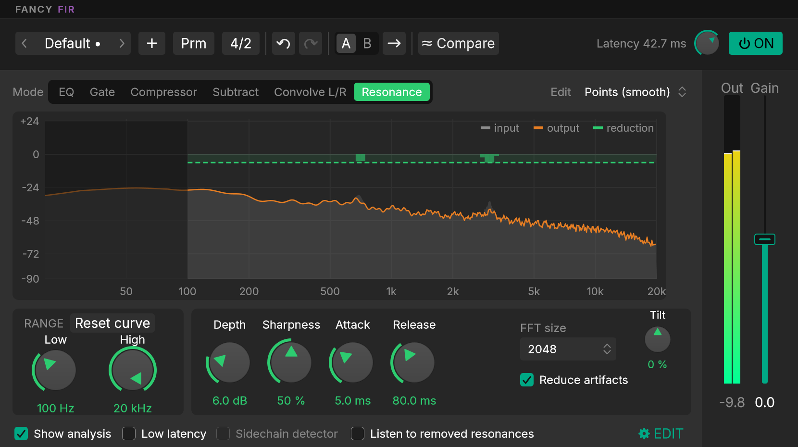

### Fancy Gate


### Fancy Limit

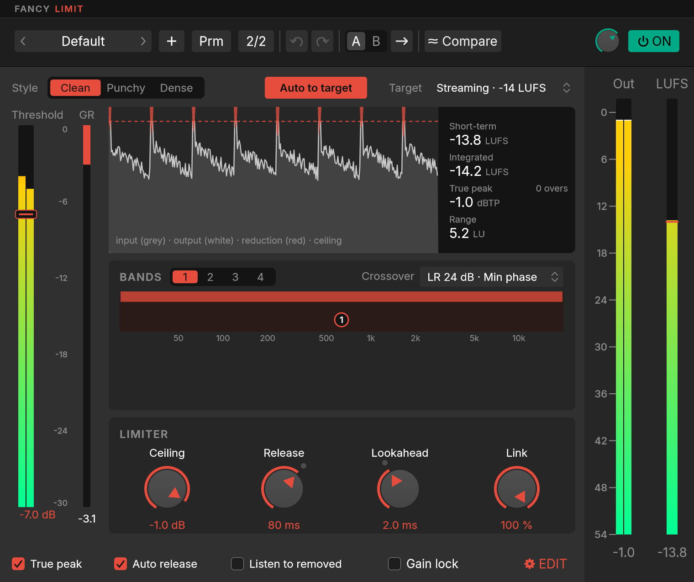

### Fancy DS


### Fancy DS-Mini

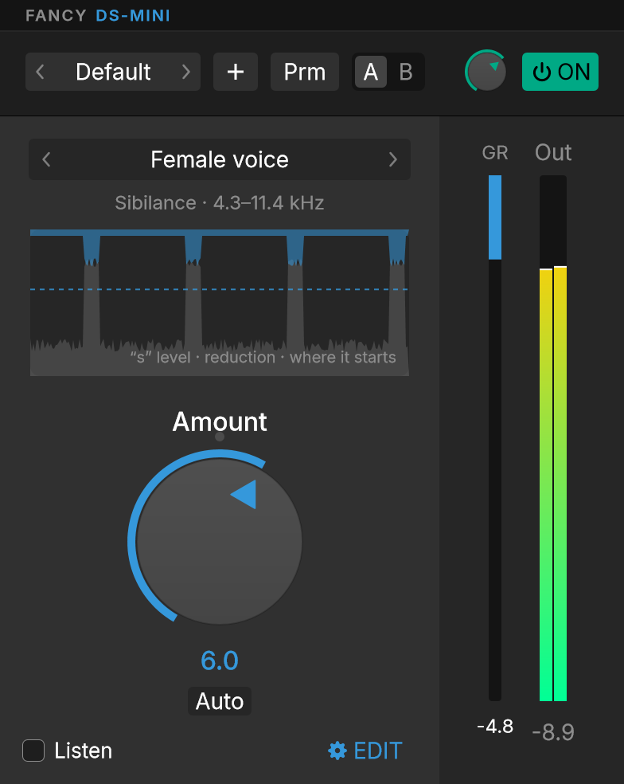

### Fancy Sature

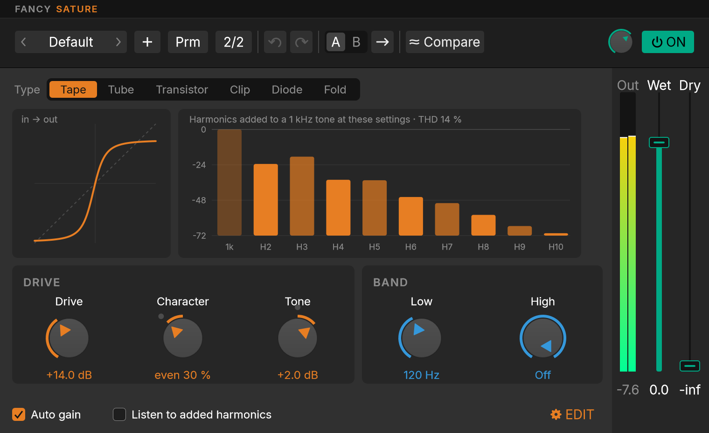

### Fancy Room


## Installing

Download the latest release's `FancyPlugs-<version>-win64.zip`. Close REAPER, unzip, and run `install.ps1`, which copies the plugins to `%USERPROFILE%\VST3-Dev`. You can also copy the `.vst3` folders to any VST3 path yourself. Then re-scan your plugins in REAPER.

To install the newest CI build instead of a release, run this in the project folder:

```powershell
.\scripts\get-latest.ps1
```

It downloads the newest successful build of the current branch and installs it the same way. It doesn't need admin rights. If REAPER is running, it first asks you to close any project using these plugins, because Windows won't overwrite a loaded DLL.

Add `%USERPROFILE%\VST3-Dev` to REAPER's VST plug-in paths once (Options > Preferences > Plug-ins > VST), and click Re-scan after each install.

## Choosing presets

Click the preset name in the header to open the preset browser. It works the same way in every plugin:

- **One click** on a preset loads it, and the browser **stays open**, so you can try several in a row.
- **Double-click** a preset, or press **Enter**, to load it and close the browser.
- Click outside the browser, or press **Esc**, to close it.
- The star marks a favourite without loading the preset.
- The ‹ › arrows on the preset name step to the previous or next preset without opening the browser.

Each plugin has a manual and a REAPER checklist in `docs/`. `docs/PROGRESS.md` has the full history, test results and measurements.

## How builds work

Nothing compiles on the local PC. Each push runs `.github/workflows/build.yml` on a GitHub Windows runner. The run builds the plugins and runs the DSP tests, Steinberg's validator, pluginval and the host harness. It also renders UI screenshots, then uploads the results as artifacts. Changes that only touch `docs/`, `reference/` or Markdown files don't start a build.

To build a single plugin, run the workflow by hand and pick it:

```powershell
gh workflow run build.yml -f plugin=kicker
```

## Attribution

UI design based on "ReaPlugs (vst GUI)" by Eugene Reznik, CC BY 4.0 — https://www.figma.com/community/file/967866927752067729. Modified from the original.

The Inter typeface is used under the SIL Open Font License; see `assets/fonts/Inter-LICENSE.txt`.
