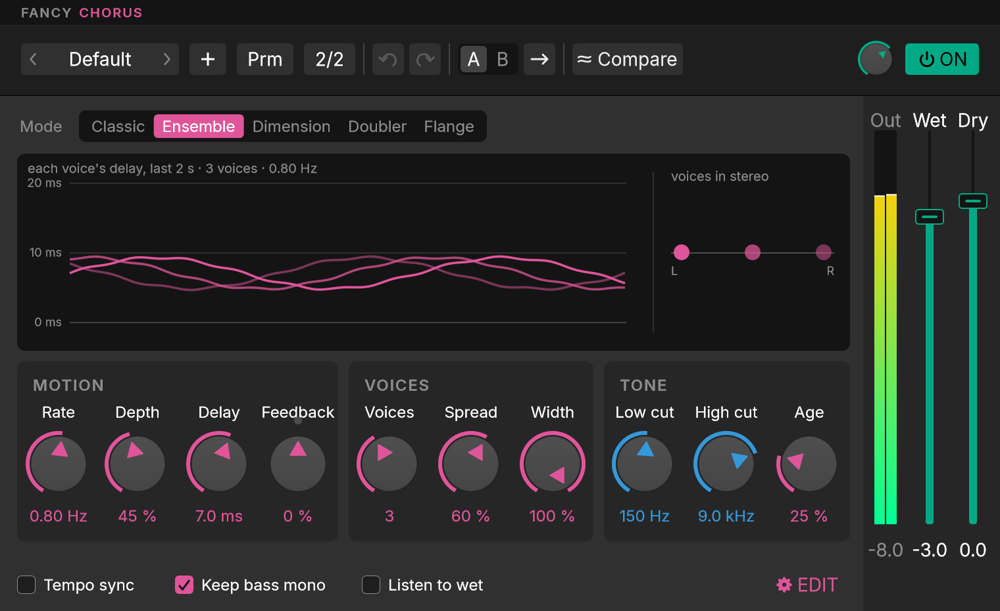
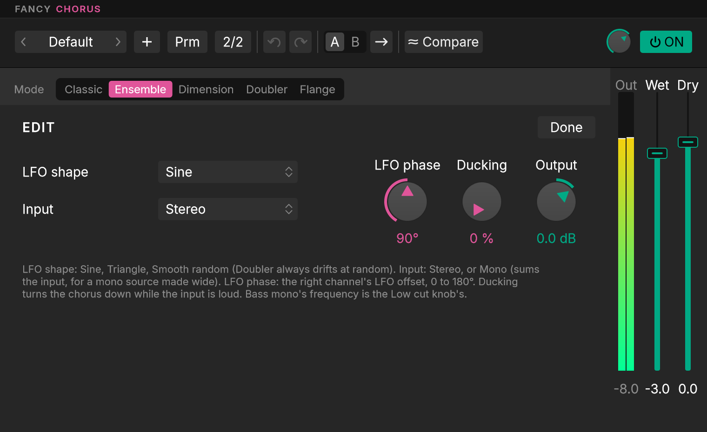

# Fancy Chorus manual

A chorus: copies of the sound, each slightly delayed and slowly moving in pitch, spread across the stereo field. Use it for width, shimmer and thickness, a doubled vocal, a vibrato or a flanger's jet sweep. Design note: `docs/chorus.md`.

## The window

1. **Mode** (top): **Classic**, one LFO with the voices offset evenly; **Ensemble**, a second, faster LFO so the voices shimmer and don't beat in step; **Dimension**, half the depth with left and right moving opposite ways, for steady width; **Doubler**, smooth random drift instead of an LFO, like a second take; **Flange**, short delays (Delay covers 0.3 to 10 ms) for jet sweeps with Feedback. Changing Mode never changes Voices.
2. **The display**: each voice's delay over the last 2 s, the first voice brightest, and on the right where each voice sits between left and right. Its caption shows the voices and the rate.
3. **MOTION**: **Rate** (0.05 to 10 Hz) is how fast the voices move: slow for width, fast for vibrato. With Tempo sync on it becomes a note length (4/1 to 1/32, plain, dotted or triplet). **Depth** (0 to 100 %) is how far each voice's delay moves, so how much its pitch wobbles: the defaults, 0.8 Hz and 45 %, detune by about 20 cents. **Delay** (1 to 30 ms) is each voice's average delay. **Feedback** (-90 to +90 %) sends the voices back into themselves; positive and negative give different combs.
4. **VOICES**: **Voices** (1 to 6), **Spread** (how far apart the voices' LFOs are: 0 moves them together) and **Width** (how far apart they sit in stereo: 0 is mono).
5. **TONE**: **Low cut** and **High cut** filter the chorus (Off at the bottom and the top). **Age** gives it an old bucket-brigade chorus's character: darker, a little saturated, with faint hiss.
6. **Footer**: **Tempo sync** locks the LFO to the host's tempo and, while the host plays, to its position in the song. **Keep bass mono** keeps the chorus's lows below the Low cut frequency in the centre. **Listen to wet** plays only the chorus voices; it turns off when you close the window and is never saved. **EDIT** opens the drawer.
7. **Right column**: the output meter, and the **Wet** (the voices, -3 dB by default) and **Dry** faders. Fancy Chorus adds no latency.

## EDIT drawer

- **LFO shape**: Sine, Triangle or Smooth random (Doubler always drifts at random).
- **Input**: Stereo keeps the input's stereo; Mono sums it first, for a mono source made wide.
- **LFO phase** (0 to 180°, 90 by default): how far the right channel's motion is behind the left's. 0 moves them together; more is wider.
- **Ducking** (0 to 100 %): turns the chorus down while the input is louder than -24 dBFS, by up to 24 dB, and brings it back over about a quarter of a second, so it fills the gaps.
- **Output**: the output level, the same as the header's knob.

## Tips

- High Feedback in Flange mode can rise by 15 dB or more at the comb's peaks: trim Output.
- For a vibrato, one voice, Wet 0 dB and Dry off (the Vibrato preset).
- On a bass or a kick-heavy loop, leave Low cut at 150 Hz or so with Keep bass mono on, so the low end stays solid.

## Presets

Default; Classic chorus and Wide pad (Instruments); Dimension width (Mix); Vocal double (Vocals); Slow flange, Vibrato and Lo-fi wobble (Creative).
