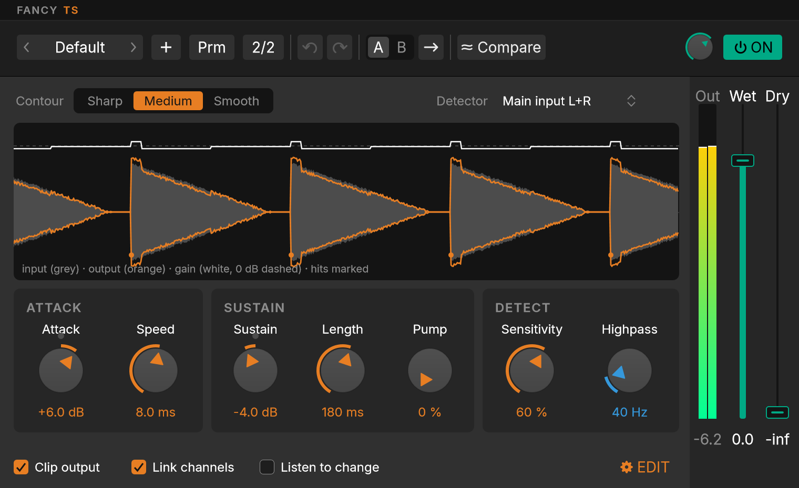
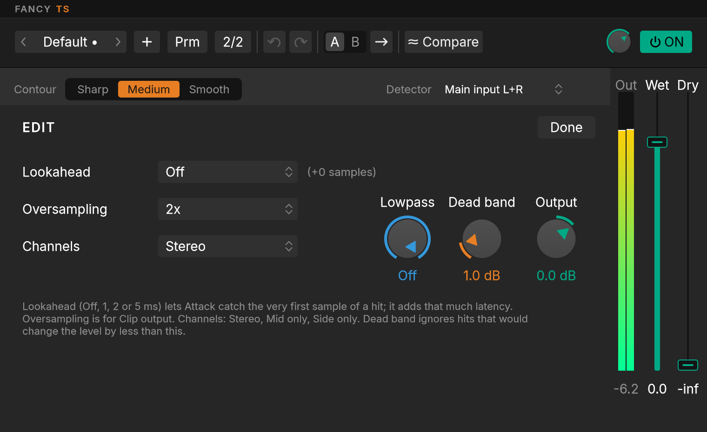

# Fancy TS manual

A transient shaper: it makes the start of each hit louder or quieter (**Attack**) and the ring after it longer or shorter (**Sustain**), whatever the level, so a quiet snare and a loud one are shaped the same. Use it to make drums snap or sit back, tighten a loop, tame a room, or bring out a pluck. Design note: `docs/ts.md`.

## The window

1. **Contour** (top left): the shape of Sustain's work over Length after each hit. **Sharp** lets go quickly and then gently, **Medium** evenly, **Smooth** holds on and then lets go.
2. **Detector** (top right): what finds the hits: this track (**Main input L+R**), the **Sidechain** (pins 3/4 in REAPER), or this track's **Mid** or **Side**. A sidechain chosen but silent shows a red note on the display.
3. **The display**: the input in grey, the output in orange and the gain Fancy TS applies as a white line (0 dB dashed, up is louder), over the last 3 s. Each detected hit is marked with a dot.
4. **ATTACK**: **Attack** turns the start of each hit up (right, to +24 dB) or down (left, to -24 dB). **Speed** (1 to 50 ms) is how long the start counts as the attack: short for clicks, longer for plucks.
5. **SUSTAIN**: **Sustain** turns the ring after each hit up or down (+-24 dB). **Length** (20 to 1000 ms) is how long after each hit it works, so it never lifts the noise between hits. **Pump** (0 to 100 %) dips the level just after each attack, for a pumping, breathing feel.
6. **DETECT**: **Sensitivity** is how small a jump in level counts as a hit (higher catches softer ones). **Highpass** keeps low notes from triggering the detector; Off at the bottom.
7. **Footer**: **Clip output** puts a soft clipper on the output, so a raised attack can't clip harshly. **Link channels** shapes both channels together from the louder one. **Listen to change** plays only what Fancy TS changes; it turns off when you close the window and is never saved. **EDIT** opens the drawer.
8. **Right column**: the output meter, and the **Wet** (shaped) and **Dry** (untouched, lined up with the shaped signal) faders, for parallel shaping.

At Attack 0, Sustain 0 and Pump 0 nothing changes: the audio passes through to the bit.

## EDIT drawer

- **Lookahead** (Off, 1, 2 or 5 ms): delays the audio so Attack acts on a hit's very first sample. It adds that much latency.
- **Oversampling** (Off, 2x, 4x): runs Clip output at a higher rate, so it doesn't alias. It only runs, and only adds latency, while Clip output is ticked.
- **Channels**: shape both channels (**Stereo**), or only the **Mid** (centre) or the **Side** (width).
- **Lowpass**: keeps highs from triggering the detector; Off at the top.
- **Dead band** (0 to 6 dB, 1 by default): hits that would change the level by less than this are left alone.
- **Output**: the output level, the same as the header's knob.

## Tips

- Snare snap: Attack +8, Speed 5 ms. Room tame: Sustain -8, Length 300 ms.
- For a kick under bright overheads, set Highpass low so cymbals don't fire it, or Lowpass so only the kick does.
- Raise Attack a lot? Tick Clip output, so the peaks round off instead of clipping.

## Presets

Default; Snare snap, Kick punch and Room tame (Drums); Tighten loop and Pump (Mix); Guitar pluck and Sustain bloom (Instruments).
